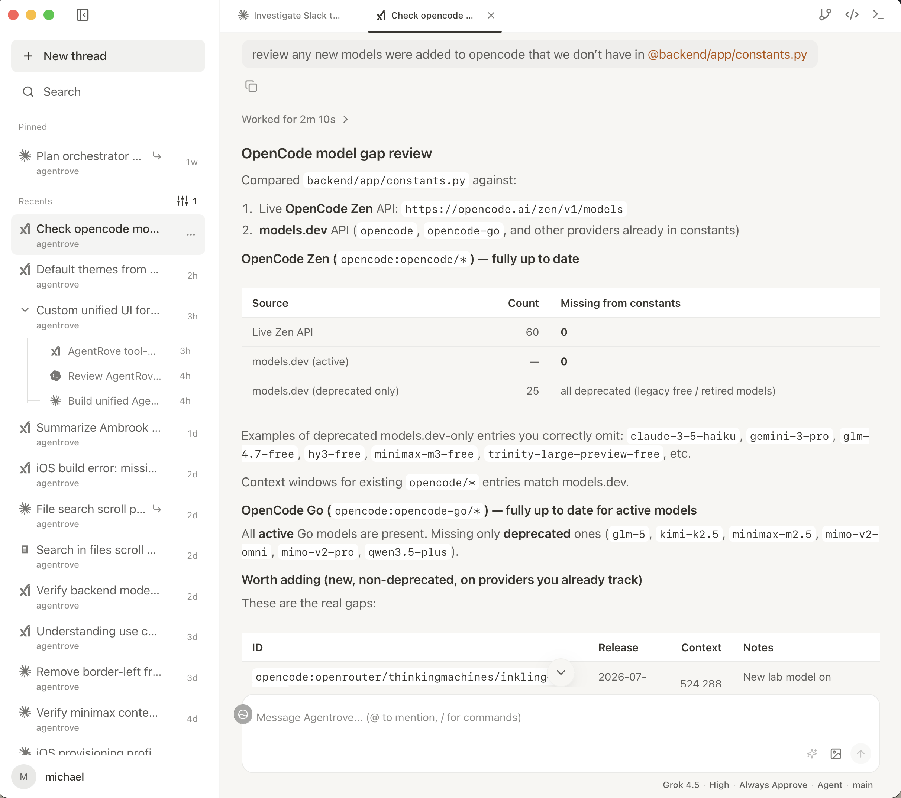

# Agentrove

Self-hosted AI coding workspace for running and orchestrating Antigravity, Claude Code, Codex, Copilot, Cursor, Grok, and OpenCode agents from one interface.

[](LICENSE)
[](https://www.python.org/)
[](https://react.dev/)
[](https://discord.gg/HvkJU8dcBA)



## What It Does

- Runs Antigravity, Claude, Codex, Copilot, Cursor, Grok, and OpenCode through ACP adapters.
- Gives each workspace its own Docker or host sandbox.
- Combines chat, code editor, terminal, file tree, diffs, secrets, and git tools in one workspace.
- Supports workspaces from empty folders, git clones, existing local folders, or GitHub repositories.
- Streams agent sessions with cancellation, permission prompts, queued follow-up messages, file mentions, slash commands, and attachments.
- Includes sub-threads, pinned chats, worktree mode, personas, custom instructions, environment variables, and installed agent skills.
- Orchestrates multi-agent workflows through the bundled MCP server: a lead chat spawns worker sub-threads on any installed agent, model, and persona — in parallel worktrees when needed — then reviews their results.
- Hosts channels: group chats where you and several agents, each with its own model and persona, discuss and work in one shared workspace.
- Provides GitHub-assisted repository browsing, pull request review, PR creation, reviewer selection, and git branch/commit/push/pull helpers.
- Ships as a Docker web app, a macOS desktop app, and a native iOS app.

## Orchestrating Agents

Agentrove chats aren't just endpoints — they can drive each other. The bundled MCP server (`mcp-server/`) exposes the whole instance as tools (`send_message`, `get_messages`, `list_models`, `list_personas`, …), and every chat's agent has those tools available. That turns any chat into an orchestrator: a lead agent on a strong model that decomposes the work, routes each task to the right agent, and reviews what comes back.

The primitives:

- **Sub-threads** — `send_message(parent_chat_id=…)` creates a worker chat grouped under the lead chat, in the same workspace and branch. Sub-threads stay flat (no nesting): the lead fans out, workers report back.
- **Per-turn model and persona** — each worker runs on any installed agent and model (`model_id`) with any persona (a custom system prompt). Typical fleet: a fast model with a read-only scout persona for codebase exploration, coding models for implementation, dedicated reviewer personas (bug hunting, structural quality) for QA. `list_models` reports each model's supported reasoning tiers (`thinking_modes`), so the lead dials effort per task.
- **Isolated worktrees** — `worktree=true` gives a worker its own git worktree, so parallel workers edit concurrently without conflicts.
- **Polling and follow-ups** — the lead polls `get_messages` until a worker's turn completes, judges the result against the actual code, and sends rework to the worker's own thread; follow-ups inherit the thread's previous model, persona, and reasoning settings.
- **Unattended turns** — orchestrated turns run in the agent's full-execution mode, so workers finish without permission prompts.

A typical loop: the lead explores with a cheap fast model, hands a precise spec to a coding model in a sub-thread, fans reviewer personas out over the diff in parallel, triages their findings, delegates the accepted fixes — and owns the final result. Models, personas, and routing rules are all user-defined, so the same machinery drives whatever fleet you run.

## Channels

Channels are group chats between you and multiple agents. Create one from the sidebar, pick a workspace (optionally a branch or a dedicated worktree), and add members — each with its own agent and model, display name, persona, thinking level, and permission mode.

- **Shared conversation** — every member sees new channel messages in batches and either posts one short reply or passes, so agents speak only when they add something: answering, disagreeing, correcting, or proposing what others missed.
- **Shared workspace** — members work in the same directory and announce which files they're about to change before editing them.
- **Live status** — the status row shows which members are thinking, typing, waiting for approval, or retrying; each reply carries a collapsed "Worked" rollup with its tool activity and duration.
- **Control** — attach files, approve permission prompts inline, and stop running members from the composer.

## Quick Start

Requirements:

- Docker
- Docker Compose

```bash
git clone https://github.com/Mng-dev-ai/agentrove.git
cd agentrove
cp .env.example .env
```

Set `SECRET_KEY` in `.env`:

```bash
openssl rand -hex 32
```

Start Agentrove:

```bash
docker compose up -d
```

Open [http://localhost:3000](http://localhost:3000).

Antigravity supports authentication through Google OAuth completed in a terminal. Its ACP tokens live in `~/.gemini/antigravity-acp/`, separately from the Antigravity CLI login.

## Desktop

Agentrove also has a macOS desktop app built with Tauri. It starts a bundled Python backend sidecar on an available `127.0.0.1` port and connects the frontend to it at launch.

- Download the latest Apple Silicon build from [Releases](https://github.com/Mng-dev-ai/agentrove/releases/latest).
- Build from source:

```bash
cd frontend
npm install
npm run desktop:dev
```

## Mobile (iOS)

Agentrove also builds a native iOS app with Tauri. Since iOS can't run the local
backend sidecar, the app is a thin client: it talks to an Agentrove instance you
already host (your Docker or production deployment), reachable from the phone over
`https`/`wss`. Because the project is open source, you build and sign it yourself —
nothing is hardcoded to anyone else's server.

Requirements: macOS with Xcode (plus its iOS SDK and Simulator), the Rust iOS
targets (`rustup target add aarch64-apple-ios aarch64-apple-ios-sim`), and CocoaPods.

> If your device runs an iOS beta whose SDK isn't in a stable Xcode yet, build against the latest stable Xcode's SDK (`sudo xcode-select -s /Applications/Xcode.app`) — apps built with an older SDK still run on newer iOS.

Point the app at your instance:

```bash
cd frontend
cp .env.mobile.example .env.mobile   # then set your https/wss URLs
npm install
```

Run in the simulator:

```bash
npm run ios:dev
```

Install on your own iPhone with a free Apple ID — no paid developer account needed
(the app must be re-signed every 7 days):

1. Add your Apple ID in **Xcode → Settings → Accounts**, then under
   **Manage Certificates** create an **Apple Development** certificate.
2. Connect your iPhone over USB, unlock it, and trust the Mac. Enable Developer
   Mode (**Settings → Privacy & Security**), then after the first install trust the
   certificate under **Settings → General → VPN & Device Management**.

Build a standalone `.ipa` and install it on the connected iPhone. The easiest path
is the bundled helper, which builds, signs, exports, and installs in one step:

```bash
cd frontend
npm run ios:install
```

It signs as the team of your Apple Development certificate (override with
`APPLE_DEVELOPMENT_TEAM=<YOUR_TEAM_ID>`), so nothing is hardcoded to anyone else's
team. It installs on the first connected iPhone/iPad, and when that device has no
valid provisioning profile yet — a new device, or a free-team profile past its 7
days — it registers the device with your team and creates the profile first.

Or run the steps yourself (open the Xcode project once with the iPhone connected and
select it as the run destination, so Xcode registers it and creates the provisioning
profile). The `-c` flag injects the team into both the build
signing and the IPA export, so it stays out of the committed config. On Xcode 27,
`CARGO_PROFILE_RELEASE_DEBUG` works around a release-link failure
([tauri#16130](https://github.com/tauri-apps/tauri/issues/16130)):

```bash
CARGO_PROFILE_RELEASE_DEBUG=line-tables-only npm run ios:build -- --export-method debugging \
  -c '{"bundle":{"iOS":{"developmentTeam":"<YOUR_TEAM_ID>"}}}'
# -> src-tauri/gen/apple/build/arm64/Agentrove.ipa

xcrun devicectl list devices   # find your device id
xcrun devicectl device install app --device <DEVICE_ID> \
  src-tauri/gen/apple/build/arm64/Agentrove.ipa
```

To update the app later, or to re-sign it after a free team's 7 days, re-run
`npm run ios:install` — the standalone build runs on the phone without keeping a Mac
connected.

### Push notifications

The iOS app gets "task completed" and "permission needed" pushes from your backend
while it's in the background or the phone is locked. Tapping one opens the chat or
channel. The lock-screen text is generic; no prompts, code, or replies are sent to Apple.

Push needs a paid Apple Developer Program membership; free-team installs can't
receive it. In the developer portal:

1. Register an App ID `com.agentrove.desktop` with the **Push Notifications** capability.
2. Create a key with **Apple Push Notifications service (APNs)** enabled (Team
   Scoped, Sandbox & Production) and download the `.p8`.

Then set these on the backend; push stays off until all three are set:

```bash
APNS_KEY="$(awk '{printf "%s\\n", $0}' AuthKey_XXXXXXXXXX.p8)"
APNS_KEY_ID=XXXXXXXXXX
APNS_TEAM_ID=<YOUR_TEAM_ID>
# APNS_TOPIC=com.agentrove.desktop  (default; change if you use another bundle ID)
```

Push is opt-in on the app side because it needs the `aps-environment` entitlement,
which free teams can't sign. Build with it enabled:

```bash
cd frontend
AGENTROVE_IOS_PUSH=1 npm run ios:install
```

This writes the entitlement into the generated Xcode project's entitlements file (a
plain `npm run ios:install` removes it again). The app picks the sandbox or
production APNs host from its provisioning profile.
Pushes respect the **Notifications** setting. Tapping a push while the app is
suspended opens its chat, but a tap that cold-launches the app may open the app's
start page instead.

## Production

For a single-host Docker deployment:

```bash
SECRET_KEY=$(openssl rand -hex 32) \
APP_URL=https://yourdomain.com \
ALLOWED_ORIGINS=https://yourdomain.com \
docker compose -f docker-compose-production.yml up -d --build
```

## Stack

- Frontend: React 19, TypeScript, Vite, Tailwind CSS, Monaco, xterm.js
- Backend: FastAPI, SQLAlchemy, SQLite, Redis
- Runtime: ACP, Docker or host sandboxes, Tauri desktop sidecar

## Community

Join the [Discord server](https://discord.gg/HvkJU8dcBA).

## Contributing

Contributions and feedback are welcome.

## License

Apache 2.0. See [LICENSE](LICENSE).
